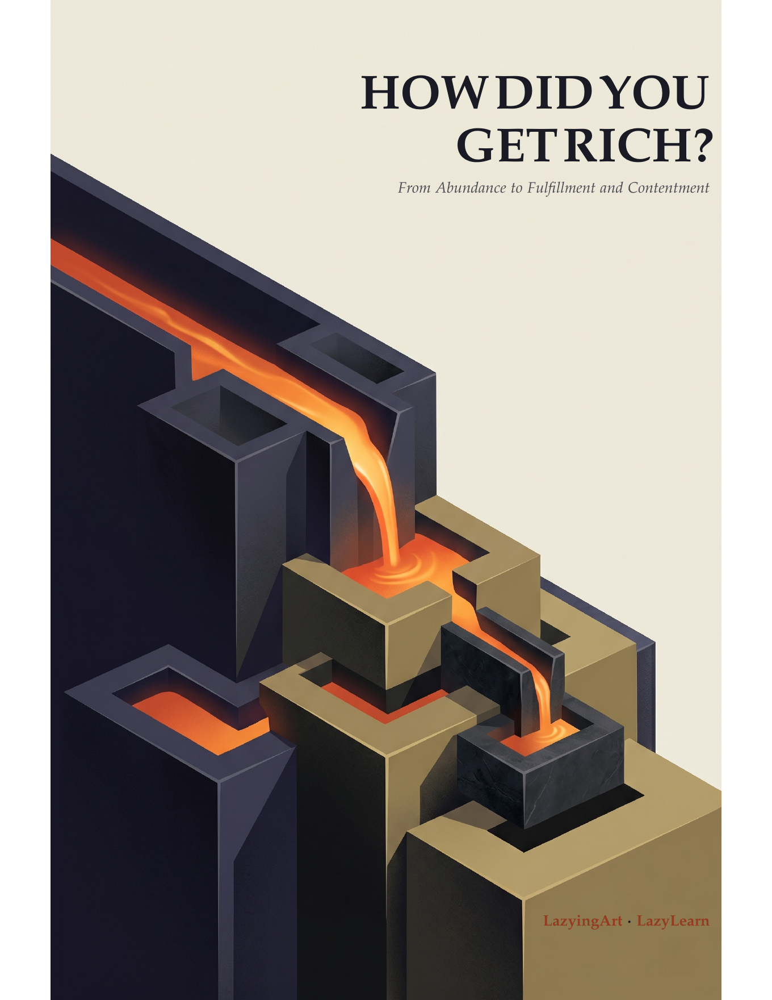

[English](../README.md) · [العربية](README.ar.md) · [Español](README.es.md) · [Français](README.fr.md) · [日本語](README.ja.md) · [한국어](README.ko.md) · [Tiếng Việt](README.vi.md) · [中文 (简体)](README.zh-Hans.md) · [中文（繁體）](README.zh-Hant.md) · [Deutsch](README.de.md) · [Русский](README.ru.md)

[](https://lazying.art)

# How Did You Get Rich?

### De la abundancia a la realización y la satisfacción de saber qué es suficiente

[](https://lachlanchen.github.io/HowDidYouGetRich/)
[](../editions/how-did-you-get-rich.pdf)
[](../editions/how-did-you-get-rich-pocket-1.2x.pdf)
[](https://github.com/sponsors/lachlanchen)

<p align="center"><a href="../editions/how-did-you-get-rich.pdf"></a></p>

*How Did You Get Rich?* investiga con franqueza cómo se crea, conserva y utiliza la
riqueza, y cómo puede convertirse en libertad en vez de una búsqueda de estatus
sin fin. Las entrevistas de School of Hard Knocks forman su columna humana y
probatoria. Sus historias se contrastan con el fracaso, la suerte, las
condiciones iniciales, los incentivos, el sesgo de supervivencia y los costes
que soportan otras personas.

## Una definición más rica de riqueza

| Abundancia · 富足 | Realización · 满足 | Suficiencia · 知足 |
| --- | --- | --- |
| Recursos, capacidades, relaciones, tiempo, resiliencia y opciones suficientes. | Trabajo y vida orientados hacia propósitos que merecen el esfuerzo. | Libertad para reconocer cuándo basta, antes de que la acumulación tome el mando. |

La libertad financiera importa porque puede abrir espacio para las tres. No
puede decidir cómo debe utilizarse ese espacio.

## Leer el libro

| Formato | Uso | Enlace |
| --- | --- | --- |
| Sitio del libro | Premisa, estructura, ediciones y novedades | [Visitar](https://lachlanchen.github.io/HowDidYouGetRich/) |
| Libro web nativo | Texto completo y buscable, ecuaciones, figuras y navegación | [Leer](https://lachlanchen.github.io/HowDidYouGetRich/chapters/note-on-the-conversations.html) |
| Mapa del libro | Buscar el texto o recorrer el argumento en cinco partes | [Explorar](https://lachlanchen.github.io/HowDidYouGetRich/book.html) |
| Ediciones PDF | Formatos opcionales para pantalla, impresión y descarga | [Abrir](https://lachlanchen.github.io/HowDidYouGetRich/reader.html) |
| PDF completo · 163 páginas | Impresión, escritorio y tabletas grandes | [Descargar](../editions/how-did-you-get-rich.pdf) |
| PDF de bolsillo 1.2x · 349 páginas | Lectores electrónicos, pantallas pequeñas e impresión 6x9 | [Descargar](../editions/how-did-you-get-rich-pocket-1.2x.pdf) |

La V2 permanece archivada en [tamaño completo](../editions/v2/how-did-you-get-rich-v2.pdf)
y [bolsillo 1.2x](../editions/v2/how-did-you-get-rich-v2-pocket-1.2x.pdf). Los enlaces
sin versión solo avanzan después de una revisión de fuentes, edición y diseño.

## El argumento

| Parte | Pregunta principal |
| --- | --- |
| I. Para qué sirve el dinero | ¿Qué clase de vida debe sostener la riqueza? |
| II. Crear algo valioso | ¿Qué elegirán, confiarán y pagarán las personas? |
| III. Poseer la máquina | ¿Cómo puede el esfuerzo convertirse en un activo que sobreviva a su creador? |
| IV. Capital, riesgo y tiempo | ¿Cómo debe crecer el dinero sin destruir a su propietario? |
| V. Libertad y suficiencia | ¿Para qué sirve la riqueza cuando sobrevivir ya no es la única pregunta? |

## Construir y verificar

Instala TeX Live con `pdflatex`, además de `python3`, `rsync`, Poppler y `qpdf`.

```bash
make full
make pocket
make verify
make verify-site
make serve
```

El sitio vive en [`docs/`](../docs/) y el libro editable en
[`source/`](../source/).

## Fuentes y agradecimientos

Esta síntesis independiente se basa en entrevistas producidas por **School of
Hard Knocks**, presentadas principalmente por **James Dumoulin**, y en las
experiencias de cada entrevistado. Su inclusión no implica revisión ni apoyo.
[`sources/interviews.csv`](../sources/interviews.csv) identifica las 135 fuentes
sin redistribuir las transcripciones.

Se agradecen correcciones sobre fidelidad, atribución, razonamiento, prosa,
accesibilidad y tipografía. Consulta [`CONTRIBUTING.md`](../CONTRIBUTING.md) y
[`RIGHTS.md`](../RIGHTS.md). Escrito y curado por
[LazyingArt](https://lazying.art) y [LazyLearn](https://learn.lazying.art).

## Apoyo

<!-- support:start -->
[](https://github.com/sponsors/lachlanchen)
[](https://chat.lazying.art/donate)
[](https://paypal.me/RongzhouChen)
[](https://buy.stripe.com/aFadR8gIaflgfQV6T4fw400)
<!-- support:end -->

## Cita

GitHub utiliza [`CITATION.cff`](../CITATION.cff) para exportar citas.

```bibtex
@book{lazyingart2026howdidyougetrich,
  author    = {{LazyingArt LLC}},
  title     = {How Did You Get Rich? From Abundance to Fulfillment and Contentment},
  year      = {2026},
  publisher = {LazyingArt and LazyLearn},
  url       = {https://github.com/lachlanchen/HowDidYouGetRich}
}
```
